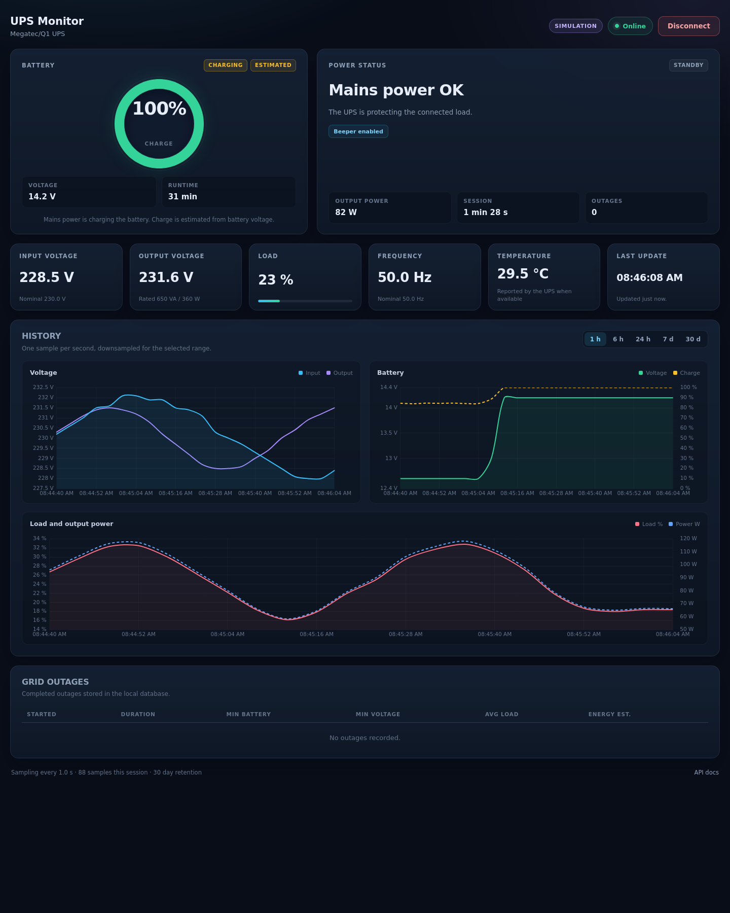

# UPS Monitor

A self-hosted web dashboard and history monitor for Megatec/Q1 UPS units.

It reads input/output voltage, load, frequency, battery voltage, temperature and
status bits directly from the UPS serial port, stores one sample per second in
SQLite and shows live values, charts and outage summaries in the browser. It
works without NUT, apcupsd or any other daemon.

The project was built for a Woxter 650 VA UPS (Megatec/Q1 protocol, 2400 baud,
8N1), but the display name, power ratings, battery capacity and voltage
thresholds are configurable.



The `SAI_` environment-variable prefix is retained from the Spanish term
*sistema de alimentación ininterrumpida* (SAI, UPS). The interface itself is in
English.

## Contents

- [What it does](#what-it-does)
- [Features](#features)
- [Requirements](#requirements)
- [Quick start with Docker Compose](#quick-start-with-docker-compose)
- [Build and run with Docker](#build-and-run-with-docker)
- [Configuration](#configuration)
- [Deploying from Portainer](#deploying-from-portainer)
- [Updating an existing deployment](#updating-an-existing-deployment)
- [Battery charge and state](#battery-charge-and-state)
- [Using the Connect / Disconnect button](#using-the-connect--disconnect-button)
- [Simulation mode](#simulation-mode)
- [API](#api)
- [Data, retention and backups](#data-retention-and-backups)
- [Local development](#local-development)
- [Tests](#tests)
- [Troubleshooting](#troubleshooting)
- [Project layout](#project-layout)
- [Contributing](#contributing)

## What it does

```text
UPS -- serial (2400 8N1) --> sampler thread --> SQLite
                                   |
                                   +--> FastAPI --> browser dashboard
                                   +--> /api/status, /api/history, /metrics
```

- A single background sampler owns the serial port and queries Q1 once per
  second.
- Each sample is persisted to SQLite. History requests are downsampled in SQL,
  so long ranges stay fast.
- Finished grid outages are stored separately with duration, minimum battery
  voltage/charge, average load and an estimated energy usage.
- The browser polls the JSON API and renders cards, charts and a recent outage
  table with Chart.js.
- The **Disconnect** button stops the sampler and closes the serial port, which
  lets a shutdown daemon or diagnostic tool take exclusive ownership of the
  device.

## Features

- Live dashboard with input/output voltage, load, frequency, battery voltage,
  temperature, output power and runtime estimates.
- History charts for 1 hour, 6 hours, 24 hours, 7 days and 30 days.
- Battery charge directly from the UPS when supported (`BL?`, `BL`, `QBL`,
  `QBV`), otherwise a clearly marked voltage-based estimate.
- Battery state label: `Charging`, `Charged`, `Recharging`, `Discharging`,
  `Low`, `Test`, `Fault` or `Unknown`.
- SQLite persistence with automatic pruning. One sample per second by default.
- Grid outage summaries with duration, minimum battery voltage/charge, average
  load and estimated energy usage.
- **Connect / Disconnect** control that really releases the serial port.
- Small JSON API plus Prometheus-style `/metrics`.
- Simulation mode for development without hardware.
- Single Docker image, non-root UID 1000, named data volume and optional fixed
  IP (macvlan) deployment with the same compose file.

## Requirements

- A Megatec/Q1 compatible UPS connected to a serial port. USB adapters such as
  `/dev/ttyUSB0` work.
- Docker with Compose v2, or Python 3.11+ for local development.
- Permission to read the serial device. On most distributions it is owned by
  `root:dialout` with mode `0660`.

The UPS should support the `Q1` command. The `F` command is optional and is
used to read the nominal input voltage, input current, battery voltage and
frequency automatically.

## Quick start with Docker Compose

```bash
git clone https://github.com/jgauchia/sai-monitor.git
cd <repository-directory>
cp .env.example .env
# Edit .env: SAI_DEVICE, SAI_DIALOUT_GID, SAI_NAME, TZ and SAI_WEB_PORT.
# Optionally set SAI_WEB_TITLE and SAI_INTERVAL.
docker compose up -d --build
```

Open `http://<host>:8000` (or the port set in `SAI_WEB_PORT`).

For a fixed container IP on an existing macvlan network, see
[Fixed container IP with macvlan](#fixed-container-ip-with-macvlan-optional).

The container always listens on port `8000`; only the published host port
changes:

```bash
SAI_WEB_PORT=8080 docker compose up -d --build
```

Check the state and logs:

```bash
docker compose ps
docker compose logs -f sai-monitor
```

### Serial device permissions

The image runs as UID 1000, not as root. Add the host group that owns the
device to the container:

```bash
stat -c '%g' /dev/ttyUSB0   # usually 20 (dialout)
```

Set `SAI_DIALOUT_GID` to that value. The compose file adds it with
`group_add`, so the container keeps running as a non-root user.

If the host device is unplugged while the container is running, the sampler
keeps retrying and the UI shows `Reconnecting`. Docker, however, requires the
device to exist when the container is **created**. For a hardware-free test,
see [Simulation mode](#simulation-mode).

## Build and run with Docker

Build the image directly:

```bash
docker build -t sai-monitor:latest .
```

Run it with a real UPS:

```bash
docker run -d \
  --name sai-monitor \
  --restart unless-stopped \
  --init \
  --stop-timeout 20 \
  -p 8000:8000 \
  --device /dev/ttyUSB0:/dev/ttyUSB0 \
  --group-add "$(stat -c '%g' /dev/ttyUSB0)" \
  -v sai_monitor_data:/data \
  -e SAI_NAME="Woxter UPS 650 VA" \
  -e SAI_WEB_TITLE="UPS Monitor" \
  -e SAI_UPS_VA=650 \
  -e SAI_UPS_WATTS=360 \
  -e SAI_BATTERY_NOMINAL=12 \
  -e SAI_BATTERY_AH=7 \
  -e TZ=Europe/Madrid \
  sai-monitor:latest
```

Run it without hardware:

```bash
docker run -d \
  --name sai-monitor \
  --restart unless-stopped \
  --init \
  -p 8000:8000 \
  -v sai_monitor_data:/data \
  -e SAI_SIMULATE=1 \
  -e TZ=Europe/Madrid \
  sai-monitor:latest
```

In both cases the named volume `sai_monitor_data` keeps the database across
container upgrades.

## Configuration

All runtime settings are environment variables. CLI flags exist in
`sai_monitor.py` for standalone use, but the container is configured through the
environment so the same image can be deployed as a Portainer stack.

> **`.env` is read by `docker compose`, not by Portainer.** When deploying from
> Portainer, enter the same variables in the stack's **Environment variables**
> section.

### Application

| Variable | Default | Description |
| --- | --- | --- |
| `SAI_NAME` | `Megatec/Q1 UPS` | Display name shown in the dashboard and API |
| `SAI_WEB_TITLE` | `UPS Monitor` | Title shown in the browser tab and dashboard header; any text is allowed |
| `SAI_INTERVAL` | `1` | Seconds between Q1 samples |
| `SAI_SIMULATE` | `0` | `1` enables the simulator and does not open a serial port |
| `SAI_LOG_LEVEL` | `INFO` | Python log level (`DEBUG`, `INFO`, `WARNING`, `ERROR`) |
| `TZ` | `UTC` | Container timezone for logs and timestamps |

`SAI_WEB_TITLE` changes both the browser tab title and the dashboard heading,
so a deployment can be labelled however you like (for example
`SAI_WEB_TITLE="Home UPS"`). `SAI_NAME` remains the UPS device name shown
underneath. Blank values fall back to `UPS Monitor`.

`SAI_INTERVAL=1` records the most detail (about 86,400 rows per day). For
long-term home monitoring, **5 seconds** is usually a better balance: it still
catches outages of more than a few seconds and reduces database growth and disk
writes by 5x. Use 2 seconds if you need to detect very short mains cuts, or
10 seconds if the database runs on a slow SD card and only long outages matter.

### Serial port

| Variable | Default | Description |
| --- | --- | --- |
| `SAI_PORT` | `/dev/ttyUSB0` | Serial device **inside** the container |
| `SAI_DEVICE` | `/dev/ttyUSB0` | Host device mapped by `docker-compose.yml` |
| `SAI_DIALOUT_GID` | `20` | Host GID that owns the serial device (compose only) |

`SAI_DEVICE` and `SAI_DIALOUT_GID` are consumed by the compose file. With a
plain `docker run`, use `--device` and `--group-add` instead.

### Storage

| Variable | Default | Description |
| --- | --- | --- |
| `SAI_DB` | `/data/sai.db` | SQLite database path |
| `SAI_RETENTION_DAYS` | `30` | Days of samples and outages to keep; `0` keeps everything |

### Web and deployment

| Variable | Default | Description |
| --- | --- | --- |
| `SAI_WEB_PORT` | `8000` | Host port published by the compose file |
| `SAI_NETWORK_NAME` | `sai_monitor_net` | Network name. Compose creates it as a bridge by default |
| `SAI_NETWORK_EXTERNAL` | `false` | Set to `true` to use an existing external network (for example macvlan) |
| `SAI_CONTAINER_IP` | empty | Optional fixed IP inside an external network; leave empty in bridge mode |

With the default `SAI_NETWORK_EXTERNAL=false`, Compose creates
`SAI_NETWORK_NAME` as a bridge network. For a fixed LAN IP, set
`SAI_NETWORK_EXTERNAL=true`, point `SAI_NETWORK_NAME` to an existing macvlan
network and set `SAI_CONTAINER_IP` to a free address in its subnet. See
[Fixed container IP with macvlan](#fixed-container-ip-with-macvlan-optional).

### UPS and battery

| Variable | Default | Description |
| --- | --- | --- |
| `SAI_UPS_VA` | `650` | UPS apparent power rating (VA) |
| `SAI_UPS_WATTS` | `360` | UPS real power rating (W) |
| `SAI_BATTERY_NOMINAL` | `12` | Fallback nominal battery voltage (V) |
| `SAI_BATTERY_AH` | `7` | Battery capacity used for runtime estimates (Ah) |
| `SAI_BATTERY_LOW` | `10.4` | Optional low voltage limit for the charge estimate |
| `SAI_BATTERY_HIGH` | `13.0` | Optional full voltage limit for the charge estimate |
| `SAI_BATTERY_STATE_LOW_V` | `11.6` | Optional low-voltage threshold for the state label |
| `SAI_BATTERY_STATE_CHARGED_V` | `13.0` | Optional float/charged threshold for the state label |
| `SAI_BATTERY_STATE_CHARGING_V` | `13.6` | Optional charging threshold for the state label |

The battery nominal voltage is read from the UPS `F` command when supported;
`SAI_BATTERY_NOMINAL` is only a fallback. The UPS rating and battery capacity
cannot be read through Megatec/Q1, so those are always configured.

When the state thresholds are empty, they are derived from
`SAI_BATTERY_NOMINAL`: `0.97`, `130/120` and `1.133` times the nominal voltage.
The defaults shown above are for a 12 V battery. The charge-estimate limits use
`104/120` and `130/120` of the nominal voltage, so the `charged` and 100 %
charge thresholds coincide.

## Deploying from Portainer

The recommended path is a Git-backed Portainer stack, because the compose file
builds the image from this repository on the Docker host.

The project repository is:

```text
https://github.com/jgauchia/sai-monitor.git
```

Use your fork's URL instead if you deploy your own copy.

1. In Portainer, go to **Stacks → Add stack**.
2. Choose **Repository**.
3. Set the **Repository URL** to the URL above and the branch to `main`.
4. Set **Compose path** to `docker-compose.yml`.
5. If the repository is private, configure the GitHub credentials in Portainer
   (username plus a personal access token with repository read access).
6. Add the environment variables in the **Environment variables** section.
7. Deploy the stack. Portainer builds the image on that host from the
   `Dockerfile`.

A minimal set for a real UPS:

```text
SAI_WEB_PORT=8000
SAI_DEVICE=/dev/ttyUSB0
SAI_DIALOUT_GID=20
SAI_NAME=Woxter UPS 650 VA
SAI_WEB_TITLE=UPS Monitor
SAI_INTERVAL=5
SAI_UPS_VA=650
SAI_UPS_WATTS=360
SAI_BATTERY_NOMINAL=12
SAI_BATTERY_AH=7
TZ=Europe/Madrid

# Optional voltage tuning:
# SAI_BATTERY_LOW=10.4
# SAI_BATTERY_HIGH=13.0
# SAI_BATTERY_STATE_LOW_V=11.6
# SAI_BATTERY_STATE_CHARGED_V=13.0
# SAI_BATTERY_STATE_CHARGING_V=13.6
```

For a hardware-free test, use:

```text
SAI_SIMULATE=1
SAI_DEVICE=/dev/null
```

Portainer does not read the local `.env` file; enter all values in the stack's
**Environment variables** section. The first deployment creates a new, empty
`sai_monitor_data` volume, so it does not inherit history from another host.

For a fixed IP on an existing macvlan network, also set
`SAI_NETWORK_EXTERNAL=true`, `SAI_NETWORK_NAME` and `SAI_CONTAINER_IP` as
described in
[Fixed container IP with macvlan](#fixed-container-ip-with-macvlan-optional).

The stack must run on the Docker host that has the UPS connected. Verify the
device and its group before deploying:

```bash
ls -l /dev/ttyUSB0
stat -c '%g' /dev/ttyUSB0
```

Use that GID for `SAI_DIALOUT_GID`. Do not scale the stack beyond one replica:
only one process can own the serial device.

If you prefer to build on the host first:

```bash
docker compose build
docker compose up -d
```

Then a Portainer stack can reference the local `sai-monitor:latest` image.

### Fixed container IP with macvlan (optional)

By default the compose file publishes a port on the Docker host and Compose
creates a bridge network named `sai_monitor_net`. For most home deployments,
the simplest way to keep a stable address is a **DHCP reservation** for the
Docker host in the router: keep the default settings and reserve the host IP.
The dashboard stays at `http://<host>:8000`.

If you need a fixed IP **for the container** on the LAN, use a macvlan network.
The same `docker-compose.yml` supports it; there is no second compose file.
Create the network once on the Docker host:

```bash
docker network create -d macvlan \
  --subnet=192.168.1.0/24 \
  --gateway=192.168.1.1 \
  -o parent=eth0 \
  sai_macvlan
```

Replace the subnet, gateway and `parent` interface with the values of the Docker
host (`ip route` and `ip -br link`).

If the macvlan network already exists (for example, created from Portainer), skip
the `docker network create` command. Open **Networks** in Portainer and check its
**Driver** and **IPAM** subnet.

Set these variables in `.env` or in the Portainer stack:

```text
SAI_NETWORK_EXTERNAL=true
SAI_NETWORK_NAME=sai_macvlan
SAI_CONTAINER_IP=192.168.1.50
```

Replace `sai_macvlan` with the exact name shown in Portainer (for example,
`doker-net` if that is your network) and use a free IP inside its subnet. Choose
an IP outside the router's DHCP pool, or reserve it in the router.

In Portainer, keep **Compose path** as `docker-compose.yml` for both modes. Do
not select a different compose file; the network mode is chosen by the
environment variables.

The container is attached to the macvlan network and to a normal bridge network
at the same time. The bridge keeps the published port working, so the dashboard
is available at both:

```text
http://SAI_CONTAINER_IP:8000   from the LAN
http://<host>:8000            through the published port
```

This also means the Docker host can use the published port even though it
normally cannot reach a macvlan address directly.

Notes:

- `parent=eth0` must be the physical interface of the Docker host. A macvlan
  parent cannot be a bridge or a VLAN sub-interface without extra setup. If the
  host uses Wi-Fi, macvlan may not work reliably; prefer the default bridge
  mode with a DHCP reservation.
- `SAI_CONTAINER_IP` is only meaningful with an existing external network
  (`SAI_NETWORK_EXTERNAL=true`) whose subnet contains that address. Leave it
  empty in bridge mode.
- The external network is not created by the stack. It must exist before you
  deploy.
- The macvlan address itself is normally not reachable from the Docker host;
  from the host, use the published port.
- If the existing network is a bridge network instead of macvlan, the fixed IP
  is internal to Docker and not reachable from the LAN. The published port still
  works at `http://<host>:8000`.

## Updating an existing deployment

The SQLite database lives in the named volume `sai_monitor_data`, not inside the
container. Recreating the container with `docker compose up -d` or Portainer's
**Update the stack** keeps the volume and all history.

> **Do not use `docker compose down -v`** unless you intentionally want to
> delete the database and every outage record. With Compose,
> `docker compose down` (without `-v`) removes the container and the
> Compose-managed networks but keeps the named volume.

### Docker Compose on the server

```bash
cd <repository-directory>
git pull

# Optional: edit .env to change the published port, title, sampling interval,
# battery thresholds, etc.
docker compose up -d --build

docker compose ps
docker compose logs -f sai-monitor
```

- `--build` is only needed when the code, Dockerfile or web assets changed.
  For an environment-only change, `docker compose up -d` is enough.
- Compose recreates the container when an environment variable changes, but
  keeps the volume.
- Check the active configuration and state:

```bash
curl -s http://127.0.0.1:8000/api/status | python3 -m json.tool
```

Common changes:

| Change | Action |
| --- | --- |
| Sampling interval | Set `SAI_INTERVAL=5` in `.env`, then `docker compose up -d` |
| Dashboard title | Set `SAI_WEB_TITLE=Home UPS` in `.env`, then `docker compose up -d` |
| Published port | Set `SAI_WEB_PORT=8080` in `.env`, then `docker compose up -d` |
| Code or frontend update | `git pull`, then `docker compose up -d --build` |
| UPS or battery settings | Edit the matching `SAI_*` variable, then `docker compose up -d` |

### Portainer

For a Git-backed stack:

1. Open **Stacks**, select the stack and click **Edit**.
2. Change the values in the **Environment variables** section.
3. Click **Update the stack**.
4. If the repository contains new code, Dockerfile or frontend changes, enable
   the option to re-pull and redeploy the image (the label depends on the
   Portainer version). The compose file builds the image from the repository.
5. Check **Containers** and the container logs. The named volume is preserved.

Portainer does not read the local `.env` file. Enter the variables directly in
the stack's **Environment variables** section, including `SAI_INTERVAL=5` or a
custom `SAI_WEB_TITLE` if you want them applied. When removing a stack, do not
enable the option to delete its volumes.

## Battery charge and state

### Charge

Megatec/Q1 does not require charge reporting. The monitor probes `BL?`, `BL`,
`QBL` and `QBV` at startup. If none works, it estimates charge from battery
voltage with the configured low/high limits and labels the value **estimated**
in both the UI and the API (`battery_charge_source: "estimated"`).

On the Woxter 650 VA used for development, only `Q1` and `F` are supported:

```text
Q1: (238.8 238.8 240.8 001 49.9 14.2 --.- 00001001
F : #230.0 002 12.00 50.0
```

So the UI shows a voltage-based estimate, not a real charge percentage.

### State label

The API exposes a `battery_state` field and the battery card shows it as a tag.
The classifier uses the Q1 voltage and status bits:

| State | Condition | Meaning |
| --- | --- | --- |
| `charging` | Mains OK and voltage at/above the charging threshold | The charger is in an active/boost phase, e.g. ~14.2 V on a 12 V battery |
| `charged` | Mains OK and voltage at/above the float threshold | Charging has finished and the battery is held at float voltage, e.g. ~13.4 V |
| `recharging` | Mains OK and voltage below the float threshold | Mains is back and the battery is recovering |
| `discharging` | Utility failure bit set | The UPS is running on battery |
| `low` | Battery-low bit set, or voltage below the low threshold | Battery is nearly empty or severely discharged |
| `test` | Test bit set | A battery test is in progress |
| `fault` | UPS-failure bit set | The UPS reports a hardware fault |
| `unknown` | No voltage or no nominal voltage available | The state cannot be determined |

Precedence is: `fault`, `test`, `low`, `discharging`, `charging`, `charged`,
`recharging`, `unknown`. Status bits always win over voltage.

For a 12 V battery the default thresholds are approximately:

- Low: `< 11.6 V`
- Recharging: `11.6 – 13.0 V`
- Charged: `13.0 – 13.6 V`
- Charging: `>= 13.6 V`

Adjust them with `SAI_BATTERY_STATE_LOW_V`, `SAI_BATTERY_STATE_CHARGED_V` and
`SAI_BATTERY_STATE_CHARGING_V`. They must be strictly increasing.

These labels are heuristics based on voltage at the UPS terminals. They are not
a chemical battery model: temperature, charger stage and load affect the
reading. Use the 7-day chart to check whether the battery stays stable around
float voltage after charging.

## Using the Connect / Disconnect button

The sampler opens the serial port when the application starts and keeps it
open while sampling. Some shutdown daemons and diagnostic tools need exclusive
access to the same UPS, so the UI provides a **Disconnect** button.

- **Disconnect** sends `POST /api/sampler/stop`. The server stops the sampler
  thread, joins it (up to 10 seconds, which also covers initial command
  detection), closes the serial port and only then responds. The UI waits for
  that response before reporting success.
- **Connect** sends `POST /api/sampler/start` and reopens the port.
- While disconnected, the last values remain visible as last known data and
  charts keep working from SQLite. `sai_sampler_running` is `0` in `/metrics`.

For a shutdown script, call the endpoint and wait for it to finish:

```bash
curl -fsS -X POST http://127.0.0.1:8000/api/sampler/stop >/dev/null
# The serial port is now free for NUT, apcupsd or another Q1 tool.
```

The exact shutdown policy (when to power off, which hosts to notify, etc.) is
intentionally left to standard Linux tooling on the host.

## Simulation mode

To test the UI without a UPS:

```bash
SAI_SIMULATE=1 SAI_DEVICE=/dev/null docker compose up -d --build
```

The `SAI_DEVICE=/dev/null` override is needed because Docker refuses to create a
container whose mapped device does not exist, even if the app is running in
simulation mode.

The simulator produces a 5-minute cycle:

| Time | Battery voltage | State |
| --- | --- | --- |
| 0–30 s | 12.6 V | `Recharging` |
| 30–180 s | 14.2 V | `Charging` |
| 180–240 s | 13.4 V | `Charged` |
| 240–300 s | 13.0 → 11.8 V, mains lost | `Discharging` / `Low` |

This exercises all chart ranges, outage records and battery state labels. Set
`SAI_SIMULATE=0` (or remove it) for the real device.

## API

| Method | Path | Description |
| --- | --- | --- |
| `GET` | `/` | Dashboard |
| `GET` | `/api/health` | Liveness and sampler state |
| `GET` | `/api/status` | Latest sample, sampler state and configuration |
| `GET` | `/api/history?hours=1&max_points=900` | Downsampled history |
| `GET` | `/api/outages?limit=20` | Finished outage summaries |
| `POST` | `/api/sampler/start` | Start sampling and open the serial port |
| `POST` | `/api/sampler/stop` | Stop sampling and release the serial port |
| `GET` | `/metrics` | Prometheus-style metrics |
| `GET` | `/docs` | Interactive OpenAPI documentation |

The dashboard and API do not include authentication. Run the monitor on a
trusted network or protect access with a VPN if it is reachable from untrusted
networks.

Example:

```bash
curl -s http://127.0.0.1:8000/api/status | python3 -m json.tool
```

The latest sample includes fields such as:

```json
{
  "event": "sample",
  "ups_name": "Woxter UPS 650 VA",
  "input_voltage": 236.7,
  "output_voltage": 236.7,
  "load_percent": 1.0,
  "battery_voltage": 13.4,
  "battery_state": "charged",
  "battery_charge": 100.0,
  "battery_charge_source": "estimated",
  "output_power_w": 3.6,
  "runtime_minutes": 252.0,
  "status": {
    "utility_fail": false,
    "battery_low": false,
    "ups_failed": false
  }
}
```

## Data, retention and backups

The named volume `sai_monitor_data` contains `sai.db` with:

- `samples`: one row per second (voltage, load, battery, status bits, power,
  runtime and charge).
- `outages`: one row per finished grid outage with summary statistics.

Old data is pruned at startup and once per hour according to
`SAI_RETENTION_DAYS`. History queries are downsampled in SQL to at most
`max_points` points.

Back up the volume with:

```bash
docker run --rm \
  -v sai_monitor_data:/data:ro \
  -v "$PWD":/backup \
  alpine tar czf /backup/sai-monitor-backup.tgz -C /data .
```

To use a bind mount instead of the named volume, replace the volume entry in
the compose file. Ensure the host directory is writable by UID 1000:

```bash
mkdir -p ./data
sudo chown 1000:1000 ./data
```

Removing the stack with `docker compose down -v` deletes the named volume and
all history.

## Local development

```bash
python3 -m venv .venv
. .venv/bin/activate
pip install -r requirements.txt

# Simulated UPS:
SAI_SIMULATE=1 uvicorn webapp:app --reload

# Real UPS:
SAI_PORT=/dev/ttyUSB0 SAI_NAME="Woxter UPS 650 VA" uvicorn webapp:app --reload
```

Open `http://127.0.0.1:8000`. The standalone dashboard and diagnostic mode can
still be used without FastAPI:

```bash
python3 sai_monitor.py --name "Woxter UPS 650 VA"
python3 sai_monitor.py --diagnose
python3 sai_monitor.py --help
```

## Tests

The test suite uses only the standard library and covers Q1/F parsing, battery
state classification, charge/power/runtime estimates, outage tracking, SQLite
queries and retention, and the sampler lifecycle:

```bash
python -m unittest discover -s tests -v
```

## Troubleshooting

**`error gathering device information while adding custom device`**

Docker requires the host device to exist when the container is created. If the
UPS is unplugged at that moment, the container will not start even though the
app itself can reconnect at runtime. Plug the UPS back in, confirm the node
exists (`ls -l /dev/ttyUSB0`) and start the stack again. For a hardware-free
test, use `SAI_SIMULATE=1 SAI_DEVICE=/dev/null`.

**`Permission denied` or `could not open port` in the logs**

Check the mapped device and GID:

```bash
stat -c '%n %u:%g %a' /dev/ttyUSB0
docker compose exec sai-monitor id
```

The container user is UID 1000. Add the GID that owns the device to
`SAI_DIALOUT_GID` and recreate the container. If a host udev rule changes the
group, update the variable accordingly.

**The UI says `Reconnecting` but the device exists**

Check that no other process owns the port:

```bash
sudo lsof /dev/ttyUSB0
```

Stop the container and run the diagnostic on the host:

```bash
python3 sai_monitor.py --diagnose
```

**No charge percentage**

Expected on many Megatec/Q1 units, including the Woxter used for development.
The value shown is an estimate derived from battery voltage and is marked
`estimated`.

**The battery state seems wrong or changes too often**

The label is derived from voltage and status bits. Check the 7-day chart and
adjust `SAI_BATTERY_STATE_LOW_V`, `SAI_BATTERY_STATE_CHARGED_V` and
`SAI_BATTERY_STATE_CHARGING_V` for your battery. A charger that switches
between boost and float can legitimately alternate between `Charging` and
`Charged`.

**The container starts but history is empty**

History is empty until the first samples arrive. In simulation mode the first
sample appears within a second; an outage appears after the first simulated
outage ends (about 5 minutes into the cycle).

**Port already in use**

Change `SAI_WEB_PORT` in `.env` (or in Portainer) and recreate the stack.

## Project layout

```text
sai_monitor.py               Megatec/Q1 parser, sampler, estimates, standalone CLI
database.py                  SQLite schema, inserts, history queries and pruning
webapp.py                    FastAPI app, background sampler and JSON API
web/index.html               Dashboard markup
web/style.css                Dashboard styles
web/app.js                   Polling, connect/disconnect, charts and outage table
web/vendor/chart.umd.min.js  Vendored Chart.js
tests/                       Unit and integration tests
docs/dashboard.png           Dashboard screenshot used in this README
Dockerfile                   Python 3.13 image, non-root UID 1000
docker-compose.yml           Single Compose/Portainer stack (bridge or macvlan)
.env.example                 Deployment environment template
```

## Contributing

Issues and pull requests are welcome. Please keep code comments, docstrings,
CLI help, README content and UI text in English, and run the test suite before
opening a pull request:

```bash
python -m unittest discover -s tests -v
node --check web/app.js
```
